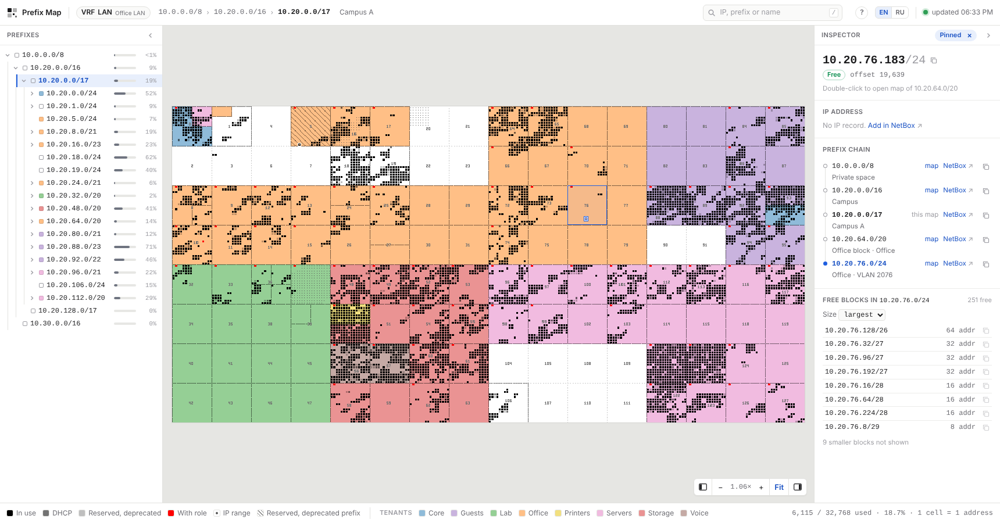
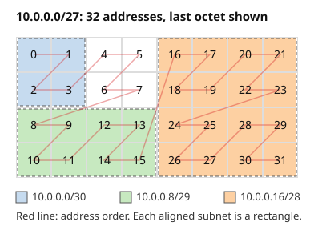
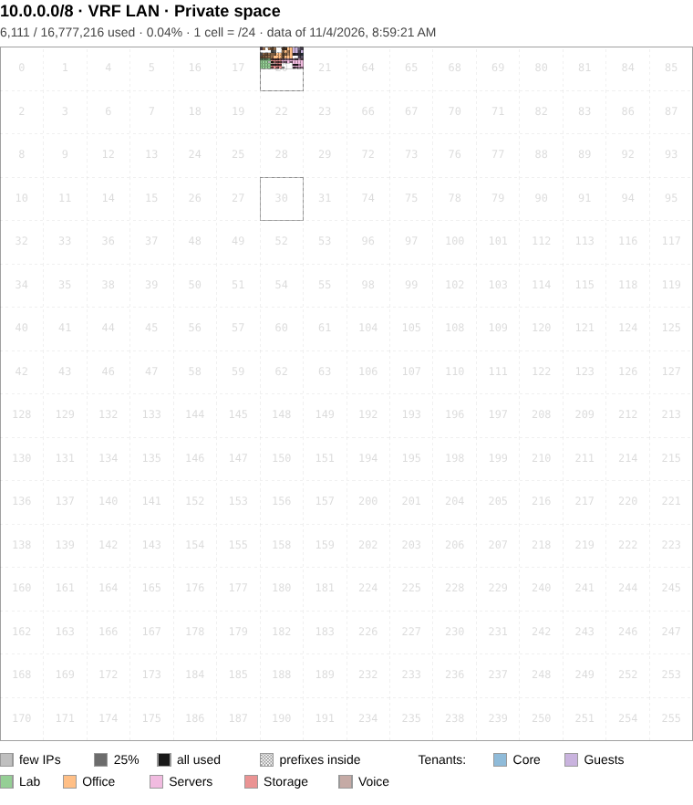
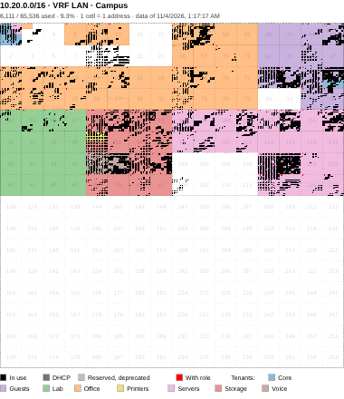
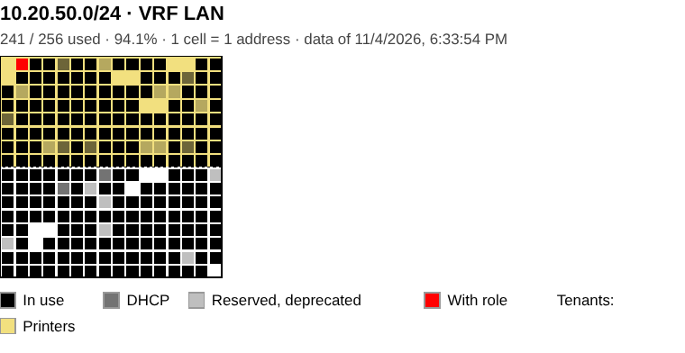

# NetBox Prefix Map

**A world map of your IPv4 space.** Every address is a cell, every subnet is a rectangle, every tenant has its own colour. See at a glance what is used, what is free and who owns it, from a /8 down to a single address.



The maps are drawn from [NetBox](https://github.com/netbox-community/netbox) prefixes and IP addresses and redrawn when NetBox reports a change through a webhook. The web interface is served under a base path (default `/prefix-map`), so it can sit on the NetBox host behind the same reverse proxy.

## What you can do

- **See the whole space.** Prefixes of /16 and longer get one cell per address, and shorter ones one cell per /24 or larger block, shaded by how many addresses are used. Child prefixes are filled with their tenant's colour, and used addresses are drawn on top: in use, DHCP, reserved, inactive, or with a role (anycast, VIP). NetBox IP ranges are marked too.
- **Inspect any address.** Hover or click a cell to see its IP record or "free", the chain of prefixes around it with links to NetBox, and the free blocks of the innermost prefix. Network and broadcast addresses are marked as such.
- **Find space.** Pick a size such as /26 to list the first free blocks of that size, then copy one with a click. Search by address, prefix, DNS name or description across all VRFs.
- **Share and print.** The URL keeps the pinned address. Print gives a vector map with title and legend, in colour or black and white with hatched tenants, and "Download SVG" saves the same drawing.
- **Work from the keyboard.** Arrow keys move the pin, Enter opens the child prefix or the IP in NetBox, `c` copies, `/` searches, `+` `-` `0` zoom.

## How to read the map

Addresses run along a Z-order (Morton) curve: the first half of a prefix is the top or left half of its map, the first quarter is the top-left quarter, and so on. Every aligned subnet is therefore a rectangle: a /24 is a 16 × 16 square on a /16 map, and a /25 is half of it. The grey numbers on the map are the octets that tell these squares apart, e.g. the third octet of each /24.



The same space at three levels, as printed:

| /8: one cell per /24 | /16: one cell per address | /24 |
|---|---|---|
|  |  |  |

The screenshots use the synthetic test dataset (`tests/synthetic_data.py`); no real data is shown.

## Requirements

- NetBox 4.x and an API token with read access to IPAM (prefixes, IP addresses, VRFs; roles and IP ranges optional) and Tenancy (tenants)
- Docker with Compose, or Python 3.13

## Configuration

Settings are read from the environment or from a `.env` file in the project directory.

| Variable | Default | Description |
|---|---|---|
| `NETBOX_API_URL` | | NetBox base URL, e.g. `https://netbox.example.com` |
| `NETBOX_API_TOKEN` | | API token |
| `NETBOX_TIMEOUT` | `30` | API request timeout, seconds |
| `BASE_PATH` | `/prefix-map` | URL path prefix of the web interface |
| `OUTPUT_DIR` | `output` | Generated files; relative paths are resolved against the project directory |
| `CELL_SIZE` | `4` | Cell size in pixels |
| `WEBHOOK_SECRET` | | Shared secret of the NetBox webhook; when set, unsigned requests are rejected |
| `UPDATE_DEBOUNCE_SECONDS` | `60` | Minimum interval between webhook-triggered updates |
| `INITIAL_UPDATE` | `1` | Set to `0` to skip the update at startup |
| `PORT` | `5000` | Listening port |

## Running

With Docker:

```bash
make up
```

The container serves requests immediately and updates the maps in the background. Generated files are kept in the `output` volume. `make logs` and `make down` show the logs and stop the container.

Without Docker:

```bash
pip install -r requirements.txt
python -m app.cli       # one-off update
python -m app.webapp    # development server
```

## NetBox setup

### Webhook

1. Operations › Integrations › Webhooks › Add: URL `http://<host>:5000/prefix-map/webhook`, method `POST`, content type `application/json`, secret as in `WEBHOOK_SECRET`.
2. Operations › Integrations › Event Rules › Add: object types IPAM › Prefix, IPAM › IP Address, IPAM › IP Range, IPAM › VRF, Tenancy › Tenant; events created, updated, deleted; action: the webhook above.

Events for other object types are ignored. A burst of events triggers one update immediately and at most one follow-up after `UPDATE_DEBOUNCE_SECONDS`.

### Map button on prefix pages

Customization › Custom Links › Add, object type IPAM › Prefix:

- Link text: `Map`
- Link URL:

  ```
  /prefix-map/map/{{ object.vrf.pk if object.vrf else 'None' }}/{{ (object.prefix | string).replace('.', '_').replace('/', '_') }}
  ```

## Reverse proxy

Apache, in the NetBox virtual host:

```apache
<Location /prefix-map>
    ProxyPass http://localhost:5000/prefix-map
    ProxyPassReverse http://localhost:5000/prefix-map
</Location>
```

Requires `mod_proxy` and `mod_proxy_http`.

## Access control

The maps show every prefix, IP address, DNS name, tenant and description that the API token can read, in images, data files, the search and the prefix tree. The app has no login of its own: restrict it at the reverse proxy, with the same rules as NetBox if that suits. Keep the webhook reachable for NetBox and protect it with `WEBHOOK_SECRET`:

```apache
<Location /prefix-map>
    ProxyPass http://localhost:5000/prefix-map
    ProxyPassReverse http://localhost:5000/prefix-map
    AuthType Basic
    AuthName "Prefix Map"
    AuthUserFile /etc/apache2/prefix-map.htpasswd
    Require valid-user
</Location>
<Location /prefix-map/webhook>
    Require ip 127.0.0.1 ::1
</Location>
```

Replace `Basic` with your SSO module (mod_auth_openidc, mod_auth_mellon, Kerberos) as needed, and the address in `Require ip` with that of the NetBox host when the webhook does not come from localhost. `/healthz` and `/metrics` carry no inventory data. `/errors` shows log lines; keep it behind the same rule. Without `WEBHOOK_SECRET`, anyone who can reach `/webhook` can trigger a full refetch from NetBox (at most one per `UPDATE_DEBOUNCE_SECONDS`).

## Endpoints

All paths are relative to `BASE_PATH`.

| Path | Description |
|---|---|
| `/` | VRF list with prefix and address counts |
| `/map/<vrf>` | Top-level prefixes of a VRF with usage |
| `/map/<vrf>/<prefix>` | Map page; `<vrf>` is the VRF id or `None` for Global, `<prefix>` uses `_` for `.` and `/` |
| `/search?q=<query>` | Maps showing an IPv4 address or prefix, or matching a name or description, across VRFs (JSON) |
| `/webhook` | NetBox webhook receiver |
| `/healthz` | Liveness and data age (JSON); used by the container healthcheck |
| `/metrics` | Prometheus metrics |
| `/help` | How to read the map |
| `/errors` | Recent warnings and errors |

## Limitations

- IPv4 only; IPv6 prefixes are skipped.
- Prefixes of /16 and longer get one cell per address. Shorter prefixes get a layered map with one cell per aligned block (/24 for a /8, at most 65,536 cells), shaded by the number of IP addresses in it.
- The updater runs inside the web process; run a single web worker.
- No authentication of its own; see [Access control](#access-control).

## Development

```bash
make test
```

Tests run offline against a synthetic dataset (`tests/synthetic_data.py`). Design notes: [docs/design.md](docs/design.md).

## Contributing

Issues and pull requests are welcome. Run `make test` before sending a change; tests run offline against the synthetic dataset. Contributions are accepted under the Apache License 2.0, as the rest of the project.

## License

Apache License 2.0, see [LICENSE](LICENSE). Free to use, modify and redistribute, commercially too. Redistributions and derivative works must keep the copyright and [NOTICE](NOTICE) with the author's name, Ilia Slepnev.
