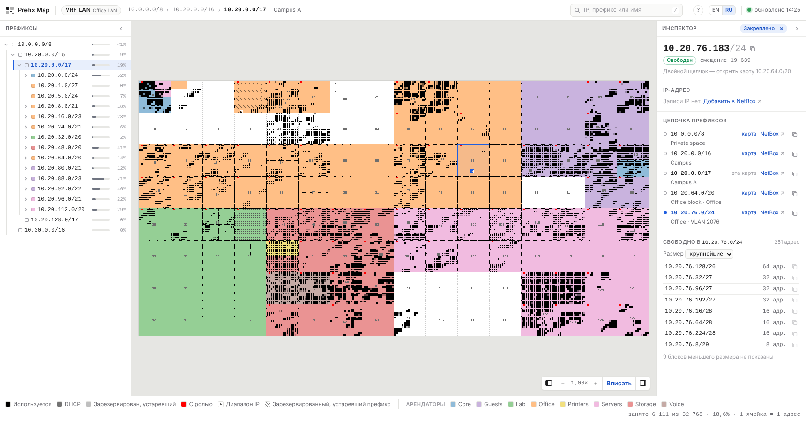
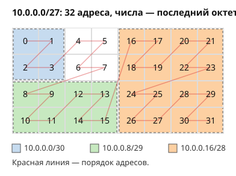
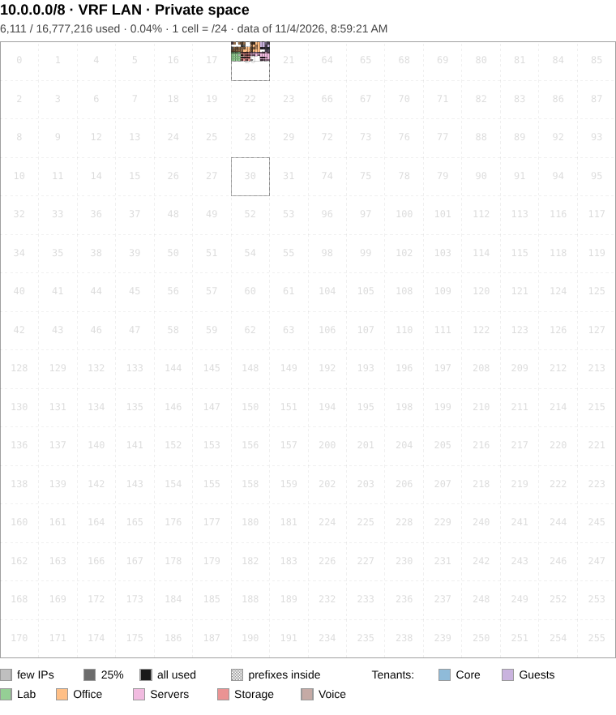
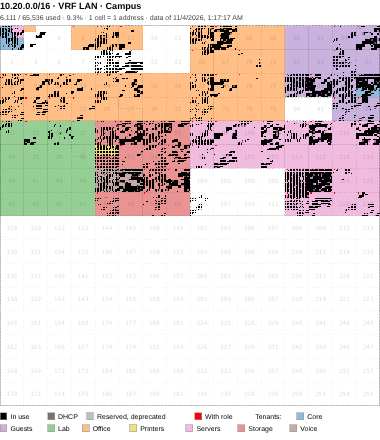
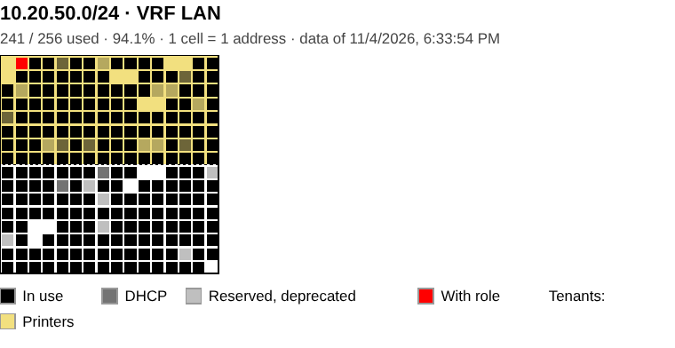

# NetBox Prefix Map

[](https://github.com/islepnev/netbox-prefix-map/actions/workflows/ci.yml)
[](#требования)
[](LICENSE)

**Карта мира для вашего адресного пространства IPv4.** Каждый адрес — ячейка, каждая подсеть — прямоугольник, каждый арендатор нарисован своим цветом, от /8 до отдельного адреса. Карты строятся по данным [NetBox](https://github.com/netbox-community/netbox) и перерисовываются, когда NetBox сообщает об изменении через webhook.



## Как читать карту

Адреса идут по Z-кривой (порядок Мортона): первая половина префикса — верхняя или левая половина карты, первая четверть — левая верхняя четверть и так далее. Поэтому любая выровненная подсеть — прямоугольник: /24 на карте /16 — квадрат 16 × 16, /25 — его половина. Серые числа на карте — октеты, по которым эти квадраты различаются, например третий октет каждой /24.



Одно и то же пространство на трёх уровнях, как при печати:

| /8: ячейка на /24 | /16: ячейка на адрес | /24 |
|---|---|---|
|  |  |  |

## Поиск, ссылки, печать

- **Поиск.** Адреса и префиксы, а также текст в DNS-именах, описаниях, именах арендаторов и ролей, во всех VRF. `свободные /26` (или `free /26`) — свободные блоки /26 во всех VRF, `свободные /26 в 10.20.0.0/16` — внутри префикса.
- **Ссылки.** Адрес страницы хранит закреплённый адрес и выделенного арендатора. `?lang=en` открывает страницу на английском; иначе язык берётся из браузера.
- **Печать.** Ctrl+P печатает только карту, в векторе, с заголовком и легендой; в чёрно-белом варианте арендаторы заштрихованы.
- **Ошибки в данных.** При каждом обновлении отмечаются записи, которые NetBox принимает, но которые скорее всего ошибочны: маска IP-адреса, не совпадающая с подсетью, адреса в контейнере вне его подсетей, адреса сети и широковещательные, записанные как IP, префиксы, записанные в VRF дважды. Сводка префикса перечисляет их, карта обводит, страница VRF показывает их число.

## Установка

На хосте NetBox, с Docker:

1. Создайте в NetBox API-токен только для чтения и запишите `.env` в каталоге проекта:

   ```ini
   NETBOX_API_URL=https://netbox.example.com
   NETBOX_API_TOKEN=<токен>
   WEBHOOK_SECRET=<любая случайная строка>
   PUBLISH_ADDR=127.0.0.1
   NETBOX_SESSION_AUTH=1
   ```

2. Запустите: `make up`.
3. Apache, в виртуальном хосте NetBox:

   ```apache
   ProxyPass        /prefix-map http://127.0.0.1:5000/prefix-map
   ProxyPassReverse /prefix-map http://127.0.0.1:5000/prefix-map
   ```

4. NetBox, Operations › Integrations:
   - Webhooks › Add: URL `http://127.0.0.1:5000/prefix-map/webhook`, секрет из `.env`.
   - Event Rules › Add: типы объектов Prefix, IP Address, IP Range, VRF, Tenant; события created, updated, deleted; действие — этот webhook.

Откройте `https://netbox.example.com/prefix-map/`. Карты появятся, когда закончится первое обновление. Они открываются пользователям, вошедшим в NetBox и имеющим там право просмотра префиксов; остальные попадают на страницу входа NetBox или видят «Отказано в доступе».

По желанию — кнопка карты на странице префикса. Customization › Custom Links › Add, тип объекта IPAM › Prefix, текст `Map`, URL:

```
/prefix-map/map/{{ object.vrf.pk if object.vrf else 'None' }}/{{ (object.prefix | string).replace('.', '_').replace('/', '_') }}
```

## Подробности

### Требования

- NetBox 4.x (доступ по учётным записям NetBox написан под 4.6). Токен читает IPAM (префиксы, IP-адреса, VRF; роли, диапазоны IP и VLAN — по желанию), Tenancy (арендаторы) и по желанию DCIM (сайты, локации, регионы, группы сайтов); то, что токен прочитать не может, пропускается с предупреждением.
- Docker с Compose или Python 3.13.

### Параметры

Читаются из окружения или из `.env` в каталоге проекта.

| Переменная | По умолчанию | Назначение |
|---|---|---|
| `NETBOX_API_URL` | | Базовый URL NetBox, например `https://netbox.example.com` |
| `NETBOX_API_TOKEN` | | API-токен |
| `NETBOX_TIMEOUT` | `30` | Таймаут запроса к API, секунды |
| `BASE_PATH` | `/prefix-map` | Префикс пути веб-интерфейса, чтобы делить хост с NetBox |
| `OUTPUT_DIR` | `output` | Каталог результатов; относительный путь отсчитывается от каталога проекта |
| `CELL_SIZE` | `4` | Размер ячейки в пикселях изображения |
| `WEBHOOK_SECRET` | | Общий секрет webhook в NetBox; если задан, неподписанные запросы отклоняются |
| `UPDATE_DEBOUNCE_SECONDS` | `60` | Серия webhook даёт одно обновление сразу и не более одного повторного через этот интервал |
| `UPDATE_INTERVAL_SECONDS` | `0` | Периодическое полное обновление, если за это время не было другого, не чаще `UPDATE_DEBOUNCE_SECONDS`; `0` — выключено |
| `INITIAL_UPDATE` | `1` | `0` — не обновлять при запуске |
| `PORT` | `5000` | Порт |
| `NETBOX_SESSION_AUTH` | `0` | `1` — открывать карты только пользователям, вошедшим в NetBox и имеющим там право просмотра префиксов |
| `NETBOX_SESSION_COOKIE` | `sessionid` | Имя cookie сессии NetBox (`SESSION_COOKIE_NAME` в NetBox) |
| `NETBOX_LOGIN_URL` | `/login/` | Страница входа NetBox для пользователей без сессии |
| `NETBOX_AUTH_CACHE_SECONDS` | `300` | Сколько хранится ответ NetBox о сессии |
| `TRUSTED_PROXIES` | `1` | Число обратных прокси перед приложением; по нему адрес клиента в журнале берётся из `X-Forwarded-For`; `0` — заголовок не учитывается |
| `PUBLISH_ADDR` | `0.0.0.0` | Docker Compose: адрес хоста, на котором публикуется порт |

### Доступ

Карты показывают все префиксы, IP-адреса, DNS-имена, арендаторов и описания, доступные токену API.

- Держите порт 5000 закрытым для сети (`PUBLISH_ADDR=127.0.0.1`): Docker публикует порты в обход фаервола хоста, а через порт можно обойти обратный прокси.
- `NETBOX_SESSION_AUTH=1` требует, чтобы приложение было на хосте NetBox: тогда браузер отправляет ему cookie сессии NetBox. Приложение спрашивает с ней API NetBox, может ли пользователь просматривать префиксы, и хранит ответ для сессии `NETBOX_AUTH_CACHE_SECONDS`. Ограничения объектных прав не применяются: пользователь, которому видна часть префиксов, видит все карты. `/static`, `/healthz`, `/metrics` и `/webhook` открыты без сессии. Если NetBox не отвечает, страницы отдают 503.
- Без этого своего входа у приложения нет: ограничьте `/prefix-map` на обратном прокси, например Apache `AuthType Basic` с `Require valid-user`, и оставьте `/prefix-map/webhook` доступным хосту NetBox.
- Без `WEBHOOK_SECRET` любой, кто достучится до `/webhook`, может запустить полную загрузку из NetBox (не чаще раза в `UPDATE_DEBOUNCE_SECONDS`).
- `/healthz` и `/metrics` не содержат данных инвентаря; `/errors` показывает строки журнала.

### Webhook

При желании добавьте в правило событий IPAM › Role, IPAM › VLAN, DCIM › Site, Location, Region, Site Group, чтобы переименования появлялись сразу. Если NetBox на другом хосте, укажите адрес, по которому он достаёт до приложения.

Если IP-адреса меняются часто и пачками, не включайте IP Address в правило событий: NetBox ставит в очередь отдельную задачу webhook на каждый изменённый объект. Вместо этого задайте `UPDATE_INTERVAL_SECONDS` (например, `900`): изменения адресов попадут на карты в пределах этого интервала, а webhook на остальные объекты по-прежнему обновит их сразу.

### Без Docker

```bash
pip install -r requirements.txt
python -m app.cli       # разовое обновление
python -m app.webapp    # сервер для разработки
```

Контейнер сразу отвечает на запросы и строит карты в фоне. Результаты хранятся в томе `output`.

## Адреса

Пути указаны относительно `BASE_PATH`.

| Путь | Назначение |
|---|---|
| `/map/<vrf>/<prefix>` | Карта; `<vrf>` — id VRF или `None` для Global, в `<prefix>` точка и `/` заменены на `_` |
| `/search?q=<запрос>` | Поиск, как в строке поиска (JSON) |
| `/webhook` | Приём webhook NetBox |
| `/healthz` | Состояние и возраст данных (JSON); используется healthcheck контейнера |
| `/metrics` | Метрики Prometheus |
| `/errors` | Последние предупреждения и ошибки |

## Ограничения

- Только IPv4; IPv6-префиксы пропускаются.
- 16 цветов арендаторов по id: у арендаторов, чьи id отличаются на 16, цвет общий.
- Префиксы короче /16 показываются по ячейке на выровненный блок, не более 65 536 ячеек.
- Обновление выполняется внутри веб-процесса; нужен один рабочий процесс веб-сервера.

## Разработка

```bash
make test    # без сети, на синтетических данных из tests/synthetic_data.py
make lint    # flake8, также в CI
```

Устройство приложения: [docs/design.md](docs/design.md). Тексты интерфейса — в `app/locales/<язык>.json` и `templates/_help_<язык>.html`; чтобы добавить язык, переведите копии английских файлов и добавьте код в `LANGUAGES` в `app/i18n.py`.

Вклад принимается на условиях Apache License 2.0, как и весь проект.

## Лицензия

Apache License 2.0, см. [LICENSE](LICENSE). Копии и производные работы должны сохранять уведомление об авторских правах и файл [NOTICE](NOTICE) с именем автора, Ilia Slepnev.
